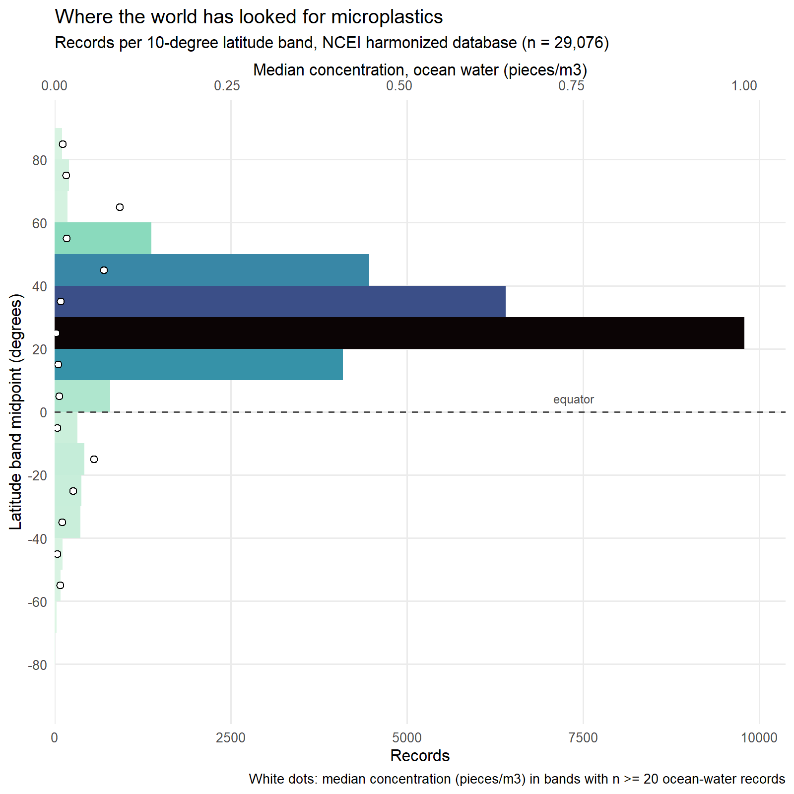
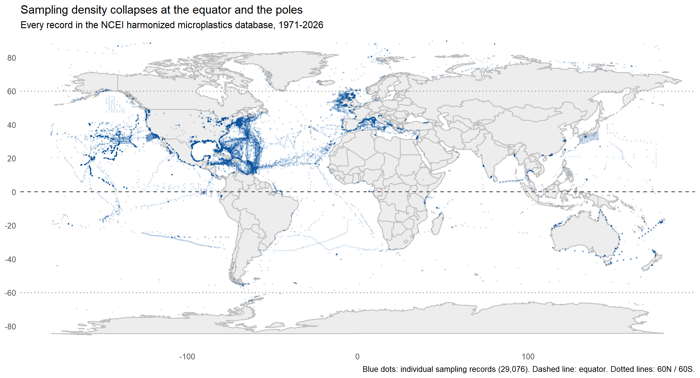
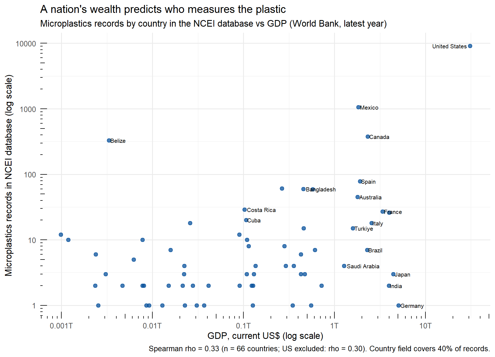

**TL;DR:** Analyzing all 29,076 records in NOAA's harmonized marine microplastics database, we find that 94.1% of the world's microplastics sampling records sit north of the equator, three-quarters fall in a single 25-55°N belt, and a country's GDP significantly predicts how many records it contributes (Spearman rho = 0.33, p = 0.007, n = 66 countries). Sampling effort tracks research money, not plastic pollution, and the gaps in the map are as telling as the dots.

## The short answer

Wealthy countries measure the ocean's plastic far more than poorer ones, and the correlation is statistically real: across 66 countries, national GDP significantly predicts how many microplastics sampling records a country contributes to the world's largest open database (Spearman rho = 0.33, p = 0.007). When we correct for population size, the relationship with wealth gets stronger, not weaker: records per million people correlate with GDP per capita at rho = 0.36 (p = 0.003). The equatorial and polar oceans, and most of the Global South, are underrepresented not because they are clean, but because almost nobody there is funded to look.

This post walks through the two analyses behind that answer: a latitude-banding of every record in the NOAA NCEI database, and a country-level correlation between sampling records and World Bank GDP figures. All the numbers below come from those analyses, run in R on the public database, and the full code is reproducible from scratch.

## What we analyzed

The [NOAA NCEI Marine Microplastics database](https://www.ncei.noaa.gov/products/microplastics) aggregates microplastics measurements from studies worldwide into a single harmonized, quality-controlled collection spanning 1972 to the present, served through an open-access map and data portal [1]. The harmonized subset we used (NCEI Accession 0306475) holds 29,076 records dated from April 1972 to April 2026, each with a location, sampling method, medium, concentration and source study. The database's designers are explicit that it is global by intent: submission is open to researchers and citizen scientists from any country, not only US-funded projects [2].

Global by intent, however, is not the same as global in fact. Two of our analyses show where the intent falls short.

## The latitude gap: 94.1% of everything north of the equator

We binned all 29,076 records into 10-degree latitude bands. The result is not a gentle North-South skew; it is a collapse.

Three findings stand out. First, 94.1% of all records sit in the Northern Hemisphere. Second, sampling is concentrated in a single temperate belt: the bands from 25°N to 55°N, covering the coasts of North America and Europe and the North Atlantic and North Pacific garbage-patch gyres, hold 75.7% of the entire database, and the 20-30°N band alone holds 9,783 records, a third of everything. Third, the gaps are at the extremes: south of 60°S there are just 27 records in more than half a century of data, and the band from 80 to 90°S contains none at all.

The map makes the pattern visible: dense blue along the eastern seaboards of the United States and Europe, sparse everywhere else. The equator is a visible dip rather than a peak, with only 786 records between 0 and 10°N, barely more than bands with a tenth of the coastline. This is not unique to our slice of the literature: a 2026 systematic review found that only about 20% of water-column microplastics studies sampled below 100 meters, with surface trawling dominating the field [3], and separate work the same year documented severe underrepresentation of the deep ocean and full water column [4]. Other researchers have reached the same conclusion from a different direction: a 2026 review of a global stormwater microplastics dataset noted that its geographic distribution reflects research infrastructure in high-income nations, with notable underrepresentation of lower-income countries, particularly in Africa and South America [5].

## The money question: does GDP predict testing?

The latitude map suggests that money, not plastic, decides where measurements happen. To test that directly, we measured "testing" as the number of database records attributed to each country in the dataset's own country field (11,684 records, or 40.2% of the database, name a country), joined it to each country's GDP, GDP per capita and population from the [World Bank's open data API](https://data.worldbank.org/indicator/NY.GDP.MKTP.CD) [6], and computed rank correlations on log-transformed values. After harmonizing country-name spellings between the two sources, 66 countries could be matched.

The correlations confirm the pattern. Total GDP predicts record counts at rho = 0.33 (p = 0.007). The relationship survives removing the United States, which alone accounts for 78% of the country-tagged records: without it, rho = 0.30 (p = 0.016). Raw GDP per capita does not significantly predict raw record counts (rho = 0.13, p = 0.28), but records per million people against GDP per capita is the strongest relationship of all, rho = 0.36 (p = 0.003): wealthier countries generate more sampling data per person, exactly what you would expect if research funding, not pollution, drives the map.

The scatter is as instructive as the correlation. Belize, a small economy, contributes 330 records because Caribbean reef programs adopted standardized sampling protocols. Japan and Germany, far larger economies, are nearly absent from the database despite intense domestic plastic research. This matches the bibliometric picture: the top ten countries account for 85.9% of micro- and nanoplastics research publications [7], and a 2026 global analysis found that research output correlates not with pollution burden but with sustained national investment, leaving high-pollution, low-capacity regions in Southeast Asia and Africa underrepresented [8].

## Why it matters: the data gap is a justice gap

These gaps have consequences beyond cartography. The regions we know least about are, by most evidence, the most exposed: commentary in The Guardian summarizes a Macquarie University-led finding that people in poorer nations face the highest microplastic exposure [9], and a 2026 strategic framework argues that overcoming the Global South's microplastics knowledge gap requires moving beyond surface-level monitoring toward local monitoring capacity and harmonized methods [10]. When international plastic-treaty negotiations and risk assessments rely on datasets that mostly describe wealthy northern waters, they inherit the blind spots of the people who funded the sampling. A map of missing data is also a map of who was not in the room.

Two honest caveats. The country field records where a sample was taken, not who funded or performed the work, so our correlation measures which nations' waters get measured, which is related to but not identical with national research capacity. And the country field covers only 40.2% of records, since open-ocean cruise data is often unattributed; the correlation should be read as describing coastal and territorial waters. Finally, the 80-90°N band's striking median concentration (1.0 pieces/m³, from 106 records) reflects Arctic ice-edge and estuary sampling rather than open-ocean conditions, so we treat that point as "measured where we happened to look."

## How to reproduce it

Everything runs in R on the public database download, and all code, charts and summary tables are open in the [NOAA-microplastics repository on GitHub](https://github.com/qtakmeel/NOAA-microplastics). Three scripts, all top-to-bottom reproducible: [`mp_analysis.R`](https://github.com/qtakmeel/NOAA-microplastics/blob/main/mp_analysis.R) (dataset overview, trends, ocean and medium breakdowns), [`mp_latitude_bands.R`](https://github.com/qtakmeel/NOAA-microplastics/blob/main/mp_latitude_bands.R) (the 10° banding and maps), and [`mp_gdp_correlation.R`](https://github.com/qtakmeel/NOAA-microplastics/blob/main/mp_gdp_correlation.R) (the country join and correlations, which downloads World Bank data live). The database itself is a single CSV from [NCEI](https://www.ncei.noaa.gov/products/microplastics) [1].

## FAQ

**Does a country's GDP really predict how much its waters get tested for microplastics?**
Yes, moderately and significantly in this database: Spearman rho = 0.33 between GDP and record count (p = 0.007, n = 66 countries), rising to rho = 0.36 for records per million people against GDP per capita. It is a rank correlation over observational data, so it shows association, not proof of mechanism.

**Why is the equator a gap if that's where shipping and fishing concentrate?**
Because the database records where researchers sample, not where plastic is. Sampling clusters around funded institutions in temperate northern countries; the equatorial dip (786 records between 0 and 10°N) reflects research geography, not pollution geography.

**What dataset can I use to do this correlation myself?**
NOAA NCEI's harmonized marine microplastics database (a single CSV, 1972-present) for testing effort, joined on its country field, and the World Bank's GDP indicator (NY.GDP.MKTP.CD) via its free API for wealth. Our [`mp_gdp_correlation.R`](https://github.com/qtakmeel/NOAA-microplastics/blob/main/mp_gdp_correlation.R) script does the full join and correlation.

**What are the limitations of this analysis?**
Three: the country field covers 40.2% of records and marks sampling location rather than funder; the database harmonizes heterogeneous methods, so record counts measure effort, not comparable pollution levels; and the US contributes 78% of country-tagged records, though the correlation holds without it.

## Sources

1. NOAA National Centers for Environmental Information, [Marine Microplastics](https://www.ncei.noaa.gov/products/microplastics) (accessed November 2026).
2. Nyadjro, E.S., Webster, J.A.B., Boyer, T.P. et al., ["The NOAA NCEI marine microplastics database"](https://www.nature.com/articles/s41597-023-02632-y), *Scientific Data* 10, 726 (2023).
3. ["Gaps and Pathways Towards Standardized, FAIR Microplastics Data Harmonization: A Systematic Review"](https://www.mdpi.com/2673-8929/5/1/11), *Microplastics* 5(1), 11 (January 2026).
4. ["Structural biases in marine microplastics research: the underrepresentation of deep ocean and full water column studies"](https://iopscience.iop.org/article/10.1088/1748-9326/ae3849), *Environmental Research Letters* (January 2026).
5. ["A global dataset of microplastics in urban stormwater runoff (2018-2024)"](https://www.nature.com/articles/s41597-026-07137-y), *Scientific Data* (April 2026).
6. World Bank, [GDP (current US$)](https://data.worldbank.org/indicator/NY.GDP.MKTP.CD), World Development Indicators (accessed November 2026).
7. ["Global Trends in the Research Landscape and Development of Micro- and Nanoplastics"](https://doi.org/10.3390/toxics14090830), *Toxics* 14(9), 830 (September 2026).
8. ["A global analysis of microplastics research: Mapping strategic funding, national research capacity, scientific priorities, and policy frameworks"](https://www.sciencedirect.com/science/article/abs/pii/S0141113626003016), *Marine Environmental Research* (2026).
9. Charron, A., ["Babies in the global south are being poisoned by plastic from the north"](https://www.theguardian.com/commentisfree/2023/nov/30/babies-in-the-global-south-are-being-poisoned-by-plastic-from-the-north-yet-they-are-missing-from-the-data), *The Guardian* (November 2023). Commentary.
10. Malafaia, G. et al., ["Strategic Roadmap for Addressing Microplastic Pollution in the Global South"](https://onlinelibrary.wiley.com/doi/10.1002/tqem.70346), *Environmental Quality Management* (April 2026).
